# Documento de Diseño del Videojuego y Arquitectura (VDD / GDD)
## Proyecto: Sintetizador de Muestra de Agua (Water Sample Puzzle)

---

## 1. Ficha Técnica del Proyecto

* **Título:** Sintetizador de Calibración de Muestra de Agua (*Water Sample Analyzer*)
* **Inspiración:** Acertijo de la Muestra de Agua de *Resident Evil 3: Nemesis* (1999)
* **Género:** Acertijo lógico / Puzzle industrial críptico
* **Plataforma:** Web (Navegador moderno / Vanilla TS + Canvas & Web Components)
* **Público Objetivo:** Evaluadores técnicos, jugadores analíticos y entusiastas de puzzles de lógica combinatoria.
* **Paradigma Principal:** Programación Orientada a Objetos (POO) estricta, Principios SOLID y Patrones de Diseño Formales (GoF).

---

## 2. Visión del Juego y Mecánicas Centrales

### 2.1. Experiencia del Usuario (Look & Feel)
El jugador se encuentra ante una terminal de tratamiento de aguas residuales de una instalación industrial abandonada. La interfaz es deliberadamente **críptica y despojada de instrucciones directas**: no existen textos como *"gana alineando las barras"* o *"pulsa aquí"*. La interfaz habla a través de su señalética, osciloscopios, luces de estado y comportamiento reactivo.

### 2.2. Componentes del Acertijo
1. **Espectro Objetivo (Target Pattern):** Una pantalla monocromática superior que despliega un vector de alturas de referencia (longitud $N$, típicamente 16 o 24 columnas, con alturas discretas de 0 a 4).
2. **Tres Filas Móviles de Bloques (Filas A, B y C):**
   * Cada fila contiene una disposición fija de bloques con diferentes alturas intercaladas con vacíos.
   * Cada fila puede desplazarse horizontalmente de forma circular (rotación a izquierda o derecha).
   * Cada fila opera como un búfer cíclico independiente.
3. **Espectro de Suma en Vivo (Live Sum Spectrum):**
   * Un panel de visualización inferior que calcula en tiempo real la suma vertical columna por columna:
     $$\text{Suma}(x) = \text{Altura}_A(x) + \text{Altura}_B(x) + \text{Altura}_C(x)$$
   * Se actualiza instantáneamente con cada desplazamiento de cualquier fila.
4. **Válvula de Confirmación / Drenaje:**
   * Interruptor o palanca mecánica que somete la combinación actual al algoritmo de verificación activo.
5. **Condición de Victoria:**
   * La suma actual coincide de forma unívoca con el vector de alturas del Espectro Objetivo.
   * **Múltiples soluciones válidas:** No se evalúa una secuencia rígida de pasos, sino la equivalencia del estado resultante.

---

## 3. Justificación y Trazabilidad de Patrones de Diseño

El sistema erradica cualquier estructura de control rígida (`if/else` o `switch` anidados para fases o reglas) mediante el uso de 5 patrones de diseño articulados orgánicamente:

```
┌───────────────────────────────────────────────────────────────┐
│                     WaterSamplePuzzle (Context)               │
│  - Mantiene estado actual: IPuzzleState                       │
│  - Mantiene estrategia de validación: IValidationStrategy     │
│  - Notifica a observadores: IPuzzleObserver                   │
└──────────────┬──────────────────┬─────────────────┬───────────┘
               │                  │                 │
     [State Pattern]     [Strategy Pattern]  [Observer Pattern]
               │                  │                 │
    ┌──────────▼─────────┐ ┌──────▼────────┐ ┌──────▼─────────┐
    │  ManipulatingState │ │ ExactMatch    │ │ LiveSumDisplay │
    │  EvaluatingState   │ │ Tolerance     │ │ SoundManager   │
    │  SolvedState       │ │ InvertedMask  │ │ AttemptCounter │
    │  LockedState       │ └───────────────┘ └────────────────┘
    └────────────────────┘
               ▲
               │ Creado por
    ┌──────────┴─────────┐
    │  [Factory Method]  │ ──> Instancia Puzzles y Matrices calibradas
    └────────────────────┘
               │
               ▼
    ┌────────────────────┐
    │ [Decorator Pattern]│ ──> Decora la presentación de bloques (Scanlines, Peaks)
    └────────────────────┘
```

### 3.1. Patrón Creacional: Factory Method
* **Problema que resuelve:** La instanciación de un puzzle requiere sincronizar la longitud del espectro objetivo, los bloques de las tres filas y garantizar que la configuración generada tenga solución matemática alcanzable. Centralizar o hardcodear esto en el juego violaría el Principio Abierto/Cerrado (OCP).
* **Contrato:**
  * `IPuzzleFactory`: Interfaz con el método `createPuzzle(): WaterSamplePuzzle`.
  * `FacilityHardFactory`: Genera la configuración fiel al puzzle original de Resident Evil 3 (1999).
  * `FacilityEasyFactory`: Genera un puzzle de 12 columnas con menor variabilidad de alturas.
  * `RandomSampleFactory`: Genera un puzzle proceduralmente garantizando resolubilidad matemática.

### 3.2. Patrón Estructural: Decorator
* **Problema que resuelve:** Permite agregar capas visuales, efectos de señal degradada (CRT Glitch) o resaltados de picos críticos a los bloques gráficos sin alterar la entidad central `Block` ni crear una explosión de subclases de renderizado.
* **Contrato:**
  * Componente base: `IBlockView` con método `render(ctx, x, y)`.
  * Componente concreto: `BaseBlockView`.
  * Decorador abstracto: `AbstractBlockDecorator implements IBlockView`.
  * Decoradores concretos: `HighlightPeakDecorator` (añade halo fosforescente a picos máximos), `ScanlineGlitchDecorator` (añade ruido estático industrial).

### 3.3. Patrón de Comportamiento: State
* **Problema que resuelve:** Modela las distintas fases del sistema eliminando banderas booleanas (`isEvaluating`, `isLocked`, `isSolved`). Las acciones del jugador cambian de efecto según la fase.
* **Contrato:**
  * `IPuzzleState`: Define métodos polimórficos `handleShift(context, row, dir)`, `handleValidate(context)`, `handleReset(context)`.
  * `StandbyState`: Ignora inputs de manipulación hasta que el sintetizador es energizado.
  * `ManipulatingState`: Permite rotar filas libremente y actualiza las proyecciones.
  * `EvaluatingState`: Bloquea temporalmente el panel mientras simula el flujo de fluidos y ejecuta la validación.
  * `SolvedState`: Bloquea los controles en modo victorioso, desactiva alarmas y drena el tanque.
  * `LockedState`: Bloquea temporalmente los controles por sobrecalentamiento tras intentos fallidos consecutivos.

### 3.4. Patrón de Comportamiento: Strategy
* **Problema que resuelve:** Desacopla la lógica de comprobación de victoria del núcleo del juego. Permite cambiar el criterio de éxito en caliente o según modos de dificultad.
* **Contrato:**
  * `IValidationStrategy`: Define el método `isValid(currentSum: number[], target: number[]): boolean`.
  * `ExactMatchStrategy`: Requiere identidad matemática absoluta ($1:1$) en todas las columnas.
  * `ToleranceStrategy`: Permite un umbral de tolerancia ($\pm 1$) en una columna marginal (modo emergencia).
  * `InvertedMaskStrategy`: Exige que la suma complete el inverso del patrón objetivo.

### 3.5. Patrón de Comportamiento: Observer
* **Problema que resuelve:** El modelo de dominio `WaterSamplePuzzle` desconoce por completo la interfaz visual, el DOM, la API de audio y los tacómetros. Cada cambio en el estado o en las filas emite un evento que actualiza los observadores registrados.
* **Contrato:**
  * Sujeto: `IPuzzleSubject` (`attach`, `detach`, `notify`).
  * Observador: `IPuzzleObserver` (`onPuzzleUpdated(currentSum, stateName, eventType)`).
  * Observadores concretos: `LiveSumSpectrumView` (dibuja el oscilograma inferior), `AttemptCounterView` (actualiza el contador de pasos), `SoundManager` (reproduce ruidos de válvulas o chispas mecánicas).

---

## 4. Matriz de Cumplimiento de Principios SOLID

| Principio | Manifestación Arquitectónica | Evidencia en Auditoría de Código |
| :--- | :--- | :--- |
| **S** (Single Responsibility) | Cada clase tiene una única razón para cambiar. `Row` gestiona índices cíclicos; `SoundManager` gestiona audio; `ExactMatchStrategy` compara arrays. | Ninguna clase de la capa `core` importa elementos de la UI ni interactúa con la API del navegador. |
| **O** (Open/Closed) | Se pueden añadir nuevos tipos de puzzles (`Factory`), nuevos filtros visuales (`Decorator`) o nuevas reglas de victoria (`Strategy`) sin modificar las clases existentes. | Las clases principales no requieren edición al incorporar extensiones. |
| **L** (Liskov Substitution) | Cualquier implementación de `IPuzzleState` o `IValidationStrategy` puede reemplazar a otra sin alterar la coherencia del flujo de `WaterSamplePuzzle`. | Los tests unitarios ejecutan la suite completa intercambiando estrategias y estados sin arrojar excepciones imprevistas. |
| **I** (Interface Segregation) | Las interfaces son pequeñas y específicas (`IPuzzleObserver`, `IBlockView`, `IValidationStrategy`). | No existen métodos vacíos tipo `throw new Error("Not implemented")`. |
| **D** (Dependency Inversion) | Las clases de alto nivel dependen de abstracciones (`IPuzzleState`, `IValidationStrategy`), nunca de implementaciones concretas. | El constructor de `WaterSamplePuzzle` recibe interfaces inyectadas mediante inversión de control. |

---

## 5. Estructura Completa de Archivos del Proyecto

```text
c:\Users\Andrés\OneDrive\Desktop\Juego_Acertijo\
├── .github/
│   └── workflows/
│       └── ci-audit.yml              # Pipeline de CI: linting estricto y tests
├── docs/
│   ├── uml/
│   │   ├── class-diagram.mermaid     # Diagrama de clases general UML 2.5
│   │   ├── state-diagram.mermaid     # Máquina de estados detallada
│   │   └── observer-sequence.mermaid # Diagrama de secuencia de eventos
│   ├── audit/
│   │   ├── black-box-checklist.md    # Protocolo formal para la prueba de jugabilidad
│   │   ├── white-box-checklist.md    # Protocolo de inspección de código y acoplamiento
│   │   └── coevaluation-rubric.md    # Plantilla de coevaluación para pares evaluadores
│   ├── architectural-traceability.md # README de trazabilidad arquitectónica
│   └── solid-matrix.md               # Análisis detallado de cumplimiento SOLID
├── src/
│   ├── core/                         # CAPA DE DOMINIO PURA (Sin dependencias de UI)
│   │   ├── models/
│   │   │   ├── Block.ts              # Entidad inmutable de bloque (altura, tipo)
│   │   │   ├── Row.ts                # Fila con rotación circular modular
│   │   │   ├── TargetPattern.ts      # Vector de alturas de la muestra objetivo
│   │   │   └── WaterSamplePuzzle.ts  # Agregado raíz / Contexto del puzzle
│   │   ├── state/                    # PATRÓN STATE
│   │   │   ├── IPuzzleState.ts       # Contrato de fases
│   │   │   ├── StandbyState.ts       # Estado de apagado / espera
│   │   │   ├── ManipulatingState.ts  # Estado activo de rotación
│   │   │   ├── EvaluatingState.ts    # Estado de comprobación y cálculo
│   │   │   ├── SolvedState.ts        # Estado de éxito (resuelto)
│   │   │   └── LockedState.ts        # Estado de penalización / sobrecalentamiento
│   │   ├── strategy/                 # PATRÓN STRATEGY
│   │   │   ├── IValidationStrategy.ts# Contrato del algoritmo de comprobación
│   │   │   ├── ExactMatchStrategy.ts # Algoritmo de igualdad exacta (RE3 clásico)
│   │   │   ├── ToleranceStrategy.ts  # Algoritmo con margen de error permitido
│   │   │   └── InvertedMaskStrategy.ts # Algoritmo de máscara complementaria
│   │   └── observer/                 # PATRÓN OBSERVER
│   │       ├── IPuzzleSubject.ts     # Contrato del sujeto observable
│   │       ├── IPuzzleObserver.ts    # Contrato del observador
│   │       └── PuzzleEventEmitter.ts # Despachador de notificaciones
│   ├── structural/                   # PATRÓN DECORATOR
│   │   ├── decorators/
│   │   │   ├── IBlockView.ts         # Componente visual base
│   │   │   ├── BaseBlockView.ts      # Renderizado estándar en canvas
│   │   │   ├── AbstractBlockDecorator.ts # Clase base abstracta del decorador
│   │   │   ├── HighlightPeakDecorator.ts # Decorador: halo para picos máximos
│   │   │   └── ScanlineGlitchDecorator.ts # Decorador: interferencia visual de CRT
│   ├── creational/                   # PATRÓN FACTORY METHOD
│   │   ├── factories/
│   │   │   ├── IPuzzleFactory.ts     # Creador abstracto
│   │   │   ├── FacilityEasyFactory.ts# Factoría para configuración de baja dificultad
│   │   │   ├── FacilityHardFactory.ts# Factoría para configuración idéntica a RE3
│   │   │   └── RandomSampleFactory.ts# Factoría con garantía de solución
│   ├── ui/                           # CAPA DE PRESENTACIÓN (Observadores concretos)
│   │   ├── components/
│   │   │   ├── TargetDisplayView.ts  # Pantalla del espectro objetivo
│   │   │   ├── RowCarouselView.ts    # Visualización y botones de rotación de filas
│   │   │   ├── LiveSumSpectrumView.ts# Visualizador en tiempo real de la suma acumulada
│   │   │   └── AttemptCounterView.ts # Tacómetro de intentos / presión hidráulica
│   │   └── styles/
│   │       ├── terminal-crt.css      # Estética industrial, verde fósforo / ámbar
│   │       └── layout.css            # Cuadrícula y paneles de instrumentación
│   ├── application/                  # CAPA DE CONTROL
│   │   ├── GameController.ts         # Mapeo de eventos de entrada hacia el State
│   │   └── SoundManager.ts           # Observador de efectos sonoros mecánicos
│   └── index.ts                      # Punto de entrada y cableado de dependencias (DI)
├── tests/                            # AUDITORÍA DE CAJA BLANCA (Tests Headless)
│   ├── unit/
│   │   ├── state-machine.test.ts     # Valida transiciones de estado sin if/else
│   │   ├── strategy-rules.test.ts    # Valida intercambio de algoritmos de victoria
│   │   ├── observer-dispatch.test.ts # Valida desacoplamiento estricto Modelo-UI
│   │   └── factory-generation.test.ts# Valida resolubilidad matemática de puzzles
│   └── mocks/
│       └── MockObserver.ts           # Espía de eventos para aserciones
├── index.html                        # Marcado semántico del laboratorio
├── package.json                      # Configuración de TypeScript y scripts de test
├── tsconfig.json                     # Tipado estricto habilitado
├── VDD.md                            # Documento de Diseño y Arquitectura (Este archivo)
└── README.md                         # Guía rápida de ejecución para evaluadores
```

---

## 6. Diagrama de Clases UML del Sistema

```mermaid
classDiagram
    direction TB

    %% Creational
    class IPuzzleFactory {
        <<interface>>
        +createPuzzle(): WaterSamplePuzzle
    }
    class FacilityHardFactory {
        +createPuzzle(): WaterSamplePuzzle
    }
    class FacilityEasyFactory {
        +createPuzzle(): WaterSamplePuzzle
    }
    IPuzzleFactory <|.. FacilityHardFactory
    IPuzzleFactory <|.. FacilityEasyFactory
    IPuzzleFactory ..> WaterSamplePuzzle : creates

    %% Subject & Model
    class IPuzzleSubject {
        <<interface>>
        +attach(observer: IPuzzleObserver): void
        +detach(observer: IPuzzleObserver): void
        +notify(): void
    }
    class WaterSamplePuzzle {
        -rows: Row[3]
        -target: TargetPattern
        -currentState: IPuzzleState
        -validator: IValidationStrategy
        -observers: List~IPuzzleObserver~
        +setState(state: IPuzzleState): void
        +setValidator(strategy: IValidationStrategy): void
        +shiftRow(rowIndex: int, direction: int): void
        +calculateSum(): int[]
        +checkSolution(): boolean
    }
    IPuzzleSubject <|.. WaterSamplePuzzle

    %% State
    class IPuzzleState {
        <<interface>>
        +handleShift(context: WaterSamplePuzzle, row: int, dir: int): void
        +handleValidate(context: WaterSamplePuzzle): void
    }
    class StandbyState {
        +handleShift(context, row, dir): void
        +handleValidate(context): void
    }
    class ManipulatingState {
        +handleShift(context, row, dir): void
        +handleValidate(context): void
    }
    class EvaluatingState {
        +handleShift(context, row, dir): void
        +handleValidate(context): void
    }
    class SolvedState {
        +handleShift(context, row, dir): void
        +handleValidate(context): void
    }
    IPuzzleState <|.. StandbyState
    IPuzzleState <|.. ManipulatingState
    IPuzzleState <|.. EvaluatingState
    IPuzzleState <|.. SolvedState
    WaterSamplePuzzle o--> IPuzzleState

    %% Strategy
    class IValidationStrategy {
        <<interface>>
        +isValid(currentSum: int[], target: int[]): boolean
    }
    class ExactMatchStrategy {
        +isValid(currentSum: int[], target: int[]): boolean
    }
    class ToleranceStrategy {
        -margin: int
        +isValid(currentSum: int[], target: int[]): boolean
    }
    IValidationStrategy <|.. ExactMatchStrategy
    IValidationStrategy <|.. ToleranceStrategy
    WaterSamplePuzzle o--> IValidationStrategy

    %% Observer
    class IPuzzleObserver {
        <<interface>>
        +onPuzzleUpdated(currentSum: int[], stateName: string): void
    }
    class LiveSumSpectrumView {
        +onPuzzleUpdated(currentSum: int[], stateName: string): void
    }
    class AttemptCounterView {
        +onPuzzleUpdated(currentSum: int[], stateName: string): void
    }
    class SoundManager {
        +onPuzzleUpdated(currentSum: int[], stateName: string): void
    }
    IPuzzleObserver <|.. LiveSumSpectrumView
    IPuzzleObserver <|.. AttemptCounterView
    IPuzzleObserver <|.. SoundManager
    WaterSamplePuzzle --> IPuzzleObserver : notifies

    %% Decorator
    class IBlockView {
        <<interface>>
        +render(ctx: CanvasRenderingContext2D, x: int, y: int): void
    }
    class BaseBlockView {
        +render(ctx, x, y): void
    }
    class AbstractBlockDecorator {
        <<abstract>>
        #wrappedView: IBlockView
        +render(ctx, x, y): void
    }
    class HighlightPeakDecorator {
        +render(ctx, x, y): void
    }
    class ScanlineGlitchDecorator {
        +render(ctx, x, y): void
    }
    IBlockView <|.. BaseBlockView
    IBlockView <|.. AbstractBlockDecorator
    AbstractBlockDecorator o--> IBlockView
    AbstractBlockDecorator <|-- HighlightPeakDecorator
    AbstractBlockDecorator <|-- ScanlineGlitchDecorator
```



---

## 7. Protocolo de Coevaluación Técnica (Doble Auditoría)

### 7.1. Auditoría de Caja Negra (Jugabilidad y Experiencia - 2 Partidas Obligatorias)
* **Partida 1: Comportamiento Críptico e Inducción.**
  * El evaluador interactúa sin manual. Comprueba si los mandos de rotación de las filas A, B y C responden con feedback auditivo y visual.
  * Valida que el panel inferior "Live Sum" altere sus columnas inmediatamente con cada clic.
  * Comprueba que enviar una combinación errónea transicione el sistema a un estado de rechazo temporal sin reiniciar arbitrariamente la posición de las filas.
* **Partida 2: Validación de Múltiples Soluciones y Condición de Victoria.**
  * El evaluador alinea las filas hasta que el histograma sumado coincida con la muestra superior.
  * Se valida que el juego reconozca el éxito sin importar cuántos pasos o rotaciones se hayan ejecutado.
  * Se comprueba que, una vez resuelto (`SolvedState`), los mandos queden bloqueados para evitar alteraciones posteriores.

### 7.2. Auditoría de Caja Blanca (Arquitectura e Inspección del Repositorio)
1. **Regla Cero Hardcoding:** Se inspecciona el código buscando bifurcaciones condicionales `if/else` o `switch` que decidan fases o validez de reglas. Se comprueba que toda variación se resuelva mediante llamadas polimórficas:
   ```typescript
   // Esperado en Caja Blanca:
   this.currentState.handleShift(this, rowIndex, direction);
   const solved = this.validator.isValid(currentSum, this.target.getHeights());
   ```
2. **Independencia Absoluta de la Capa Core:** El evaluador verifica que en `src/core/` no exista ninguna mención a `window`, `document`, `HTMLElement` o APIs del navegador.
3. **Prueba de Desconexión de Observadores:** El evaluador comenta la línea `puzzle.attach(soundManager)` en `index.ts` y comprueba que el juego compile, ejecute sus tests y funcione sin excepciones.
4. **Inspección de Decoradores:** Se comprueba que `HighlightPeakDecorator` envuelva a un objeto que implementa `IBlockView` sin tocar la clase de datos `Block`.

---

## 8. Backlog de Hitos de Desarrollo

- [x] **Hito 0: Infraestructura y Modelos Estáticos**
  - Creación del árbol de directorios y configuración del compilador estricto (`tsconfig.json`).
  - Creación de interfaces base (`IPuzzleState`, `IValidationStrategy`, `IPuzzleObserver`, `IPuzzleSubject`, `IBlockView`, `IPuzzleFactory`).
- [x] **Hito 1: Motor de Dominio y State Machine (Headless)**
  - Implementación de `Row` (lógica de rotación circular de arreglos numéricos).
  - Implementación de `WaterSamplePuzzle` y sus estados (`Standby`, `Manipulating`, `Evaluating`, `Solved`, `Locked`).
  - Tests unitarios de máquina de estados.
- [x] **Hito 2: Estrategias de Validación y Fábricas**
  - Implementación de `ExactMatchStrategy` y `ToleranceStrategy`.
  - Implementación de `FacilityHardFactory` y `FacilityEasyFactory`.
  - Tests unitarios matemáticos de validación de vectores.
- [x] **Hito 3: Bus de Eventos y Desacoplamiento (Observer)**
  - Implementación del sistema de suscripción y notificación.
  - Implementación de observadores mock para validación de flujo de eventos.
- [x] **Hito 4: Interfaz de Usuario y Decoradores Visuales**
  - Construcción de los componentes visuales en Canvas / Web Components con paleta industrial CRT.
  - Implementación de los decoradores gráficos (`HighlightPeakDecorator`, `ScanlineGlitchDecorator`).
  - Conexión de `GameController` y observadores visuales reales.
- [x] **Hito 5: Ensayos de Coevaluación y Cierre de Documentación**
  - Ejecución de las listas de chequeo de Caja Negra y Caja Blanca.
  - Generación de evidencias finales y congelamiento de versión para entrega.
